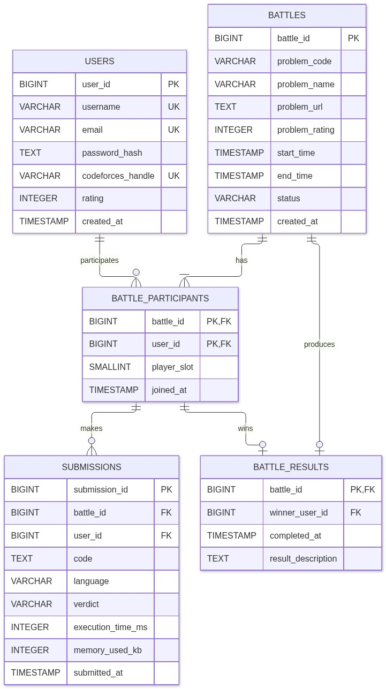
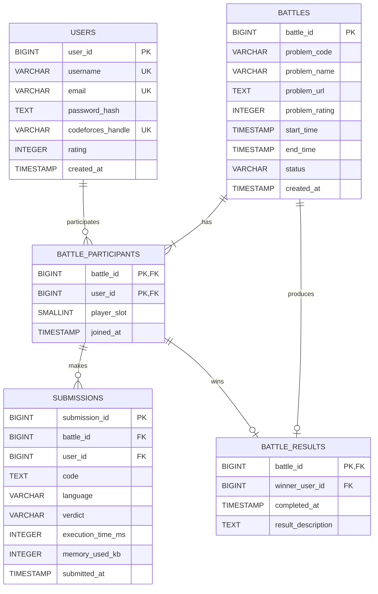

# CP Battle - Entity Relationship (ER) Diagram

## 1. Visual Entity Relationship Diagram

---

## 2. Entity & Attribute Specifications

### A. `USERS`
Stores player account authentication, profile details, and global competitive standing.
- `user_id` (`BIGINT`, PK): Unique surrogate key generated via `GENERATED ALWAYS AS IDENTITY`.
- `username` (`VARCHAR(50)`, UK, NOT NULL): Unique platform handle.
- `email` (`VARCHAR(255)`, UK, NOT NULL): Unique player contact and login identifier.
- `password_hash` (`TEXT`, NOT NULL): Cryptographically hashed password.
- `codeforces_handle` (`VARCHAR(50)`, UK): Verified handle on Codeforces for problem synchronization.
- `rating` (`INTEGER`, NOT NULL, DEFAULT 0): Elo/Glicko-style competitive battle rating.
- `created_at` (`TIMESTAMP`, NOT NULL, DEFAULT CURRENT_TIMESTAMP): Account creation timestamp.

### B. `BATTLES`
Manages the competitive 1v1 match lifecycle and Codeforces problem assignment.
- `battle_id` (`BIGINT`, PK): Unique surrogate match identifier.
- `problem_code` (`VARCHAR(30)`, NOT NULL): Official Codeforces problem ID (e.g., `'158A'`).
- `problem_name` (`VARCHAR(255)`, NOT NULL): Human-readable problem title.
- `problem_url` (`TEXT`): Direct link to the problem statement.
- `problem_rating` (`INTEGER`): Codeforces difficulty score (e.g., 800, 1500).
- `start_time` (`TIMESTAMP`, NOT NULL): Match commencement timestamp.
- `end_time` (`TIMESTAMP`, NOT NULL): Match cutoff deadline (`CHECK (end_time > start_time)`).
- `status` (`VARCHAR(20)`, NOT NULL, DEFAULT `'waiting'`): State machine: `'waiting'`, `'active'`, `'completed'`, `'cancelled'`.
- `created_at` (`TIMESTAMP`, NOT NULL, DEFAULT CURRENT_TIMESTAMP): Match creation timestamp.

### C. `BATTLE_PARTICIPANTS`
Associative entity connecting players to battles while enforcing strict two-player head-to-head matching.
- `battle_id` (`BIGINT`, PK, FK): References `battles(battle_id) ON DELETE CASCADE`.
- `user_id` (`BIGINT`, PK, FK): References `users(user_id) ON DELETE CASCADE`.
- `player_slot` (`SMALLINT`, NOT NULL): Slot assignment (`CHECK (player_slot IN (1, 2))`).
- `joined_at` (`TIMESTAMP`, NOT NULL, DEFAULT CURRENT_TIMESTAMP): Participant queue joining time.
- *Constraints:* Composite Primary Key `(battle_id, user_id)` and Unique Constraint `UNIQUE (battle_id, player_slot)` prevent duplicate registrations and slot collisions.

### D. `SUBMISSIONS`
Logs all solution attempts submitted by players during active battles.
- `submission_id` (`BIGINT`, PK): Unique submission identifier.
- `battle_id` (`BIGINT`, FK): References `battle_participants(battle_id)`.
- `user_id` (`BIGINT`, FK): References `battle_participants(user_id)`.
- `code` (`TEXT`, NOT NULL): Full source code payload.
- `language` (`VARCHAR(50)`, NOT NULL): Programming language runtime (e.g., `'GNU C++20'`, `'Python 3'`).
- `verdict` (`VARCHAR(30)`): Codeforces judge response (`'OK'`, `'WRONG_ANSWER'`, `'TIME_LIMIT_EXCEEDED'`).
- `execution_time_ms` (`INTEGER`): Program CPU time (`CHECK (execution_time_ms >= 0)`).
- `memory_used_kb` (`INTEGER`): Peak resident memory (`CHECK (memory_used_kb >= 0)`).
- `submitted_at` (`TIMESTAMP`, NOT NULL, DEFAULT CURRENT_TIMESTAMP): Submission timestamp.

### E. `BATTLE_RESULTS`
Records the finalized victory state for completed matches.
- `battle_id` (`BIGINT`, PK, FK): References `battles(battle_id) ON DELETE CASCADE`.
- `winner_user_id` (`BIGINT`, FK): References `battle_participants(battle_id, winner_user_id)` to guarantee the winner was an active match participant.
- `completed_at` (`TIMESTAMP`, NOT NULL, DEFAULT CURRENT_TIMESTAMP): Match completion timestamp.
- `result_description` (`TEXT`): Human-readable summary of win condition.

---

## 3. Cardinality & Relational Mechanics

| Primary Entity | Foreign Entity | Cardinality | Notation | Business Rule |
|---|---|---|---|---|
| `USERS` | `BATTLE_PARTICIPANTS` | 1 to Many ($1:N$) | `USERS ||--o{ BATTLE_PARTICIPANTS` | A user can register and compete in 0 or multiple battles over time. |
| `BATTLES` | `BATTLE_PARTICIPANTS` | 1 to Many ($1:N$, max 2) | `BATTLES ||--|{ BATTLE_PARTICIPANTS` | Each battle requires participants; constrained to exactly 2 slots (1v1). |
| `BATTLE_PARTICIPANTS` | `SUBMISSIONS` | 1 to Many ($1:N$) | `BATTLE_PARTICIPANTS ||--o{ SUBMISSIONS` | Each participant may submit 0 or multiple solution attempts per battle. |
| `BATTLES` | `BATTLE_RESULTS` | 1 to Zero/One ($1:0..1$) | `BATTLES ||--o| BATTLE_RESULTS` | A battle produces at most one final result record upon completion. |
| `BATTLE_PARTICIPANTS` | `BATTLE_RESULTS` | 1 to Zero/One ($1:0..1$) | `BATTLE_PARTICIPANTS ||--o| BATTLE_RESULTS` | The recorded winner must be one of the participants of that specific battle. |

---

## 4. Integrity Constraints & Referential Design Rationale

1. **Strict 1v1 Matchmaking Invariance:**
   - Enforced by `UNIQUE (battle_id, player_slot)` and `CHECK (player_slot IN (1, 2))` on `battle_participants`, mathematically forbidding a third player from joining any battle.
2. **Cascading Cleanups:**
   - Deleting a test battle cascades to its participants, submissions, and result record (`ON DELETE CASCADE`), ensuring no orphaned logs.
3. **Winner Provenance Validation:**
   - Composite foreign key `FOREIGN KEY (battle_id, winner_user_id) REFERENCES battle_participants(battle_id, user_id)` guarantees that an external user who never participated cannot be assigned as the winner.
4. **Normalized 3NF Compliance:**
   - No transitive dependencies exist. Submissions tie directly to the composite participation key without duplicating player metadata or match metadata.
